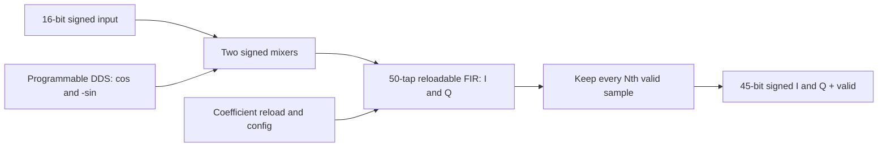

# NCO FIR Filter

VHDL digital downconverter with a programmable NCO, reloadable FIR filter, and configurable decimation for AMD FPGAs.

The design converts a continuous signed 16-bit real input into filtered I/Q samples. It targets the Kintex UltraScale `xcku060-ffva1156-2-i` and uses AMD DDS Compiler, Multiplier Generator, and FIR Compiler IP. The supplied IP configurations use a 128 MHz clock and sample rate; this is a configuration target, not a claim of board timing closure.



## Repository layout

| Path | Purpose |
| --- | --- |
| `HDL/TopM.vhd` | DDS, mixer, FIR, and decimator integration |
| `HDL/programmble_Dec.vhd` | Programmable decimator; legacy filename, entity `decimator` |
| `IP/*/*.xci` | Text IP customizations extracted from the original core containers |
| `Coe/fir_nco_40Mbw.coe` | 50 signed 16-bit coefficients in hexadecimal |
| `Constraints/timing.xdc` | 128 MHz clock constraint |
| `scripts/create_project.tcl` | Rebuild the Vivado project and regenerate IP |
| `scripts/run_tests.py` | Run self-checking RTL simulations |
| `tests/` | Decimator tests and wrapper tests with behavioral IP doubles |
| `docs/IMPLEMENTATION.md` | Arithmetic, interface contracts, review findings, and verification scope |

Generated projects, caches, waveforms, checkpoints, and binary `.xcix` containers are excluded from Git. Existing local `Prj/` files and original core containers are kept on disk. A fresh clone is rebuilt using the script below.

## Build with Vivado

Use **Vivado 2025.2**, matching the checked-in IP customizations. Run from the repository root in a shell where Vivado is on `PATH`:

```sh
vivado -mode batch -source scripts/create_project.tcl
```

Open `build/release/NCO_FIR_Filter.xpr` in Vivado. To regenerate the project, synthesize the IP and top level, and write utilization and timing reports:

```sh
vivado -mode batch -source scripts/create_project.tcl -tclargs --synth
```

To include all three Integrated Logic Analyzers, generate the debug variant:

```sh
vivado -mode batch -source scripts/create_project.tcl -tclargs --debug --synth
```

This produces `build/debug/NCO_FIR_Filter.xpr` and sets `ENABLE_DEBUG=true`. The default is `false`, so normal synthesis removes the ILA instances. The script replaces only its generated build variant when rerun; keep hand-maintained changes in the source files and script.

On Windows, run these commands in the Vivado command prompt, or invoke the full path to `vivado.bat` from PowerShell. All source paths are resolved relative to the script, so the project can be cloned into another directory.

Only the clock is constrained. Add your board's pin assignments, I/O standards, input/output delays, and reset constraints before implementation and bitstream generation.

## Run RTL tests

Requires Python 3.8+ and either GHDL with VHDL-2008 support or Vivado XSim. No Python packages are required.

```sh
python scripts/run_tests.py --simulator ghdl
```

With Vivado tools on `PATH`:

```sh
python scripts/run_tests.py --simulator xsim
```

Or specify their location explicitly:

```powershell
python scripts/run_tests.py --simulator xsim --vivado-bin "C:/AMDDesignTools/2025.2/Vivado/bin"
```

The tests cover all 256 decimation-factor encodings, signed I/Q extraction, invalid-cycle gaps, updates during traffic, asynchronous reset, and mixer/valid alignment. A separate negative test deliberately stalls the FIR and must trigger the wrapper assertion. Its expected failure message is part of a successful regression run.

GitHub Actions runs the portable suite with GHDL on pushes and pull requests. `tests/ip_models.vhd` contains **test doubles**, not models of the DDS waveform or FIR response. These tests verify the custom RTL and wiring; they do not replace vendor-IP simulation or hardware verification. Never add the test doubles to a synthesis fileset.

## Top-level interface

All inputs belong to the `clk` domain. Signed numbers use two's complement.

| Port | Direction / width | Meaning |
| --- | --- | --- |
| `clk`, `rst` | Input, 1 each | Sample clock; active-high reset |
| `input_data` | Input, 16 | Continuous real input; one sample per clock once DDS output is valid |
| `NCO_factor`, `NCO_factor_valid` | Input, 32 / 1 | DDS phase increment and configuration-valid strobe |
| `fir_coe_data` | Input, 16 | Next coefficient-reload word |
| `fir_load_valid`, `fir_coe_last` | Input, 1 each | Reload valid and last-word marker |
| `fir_load_ready` | Output, 1 | Reload word accepted when both ready and valid are high |
| `fir_config_valid`, `fir_config_ready` | Input / output, 1 each | Configuration handshake applying a pending reload; configuration data is fixed at zero |
| `Dec_factor`, `Dec_factor_valid` | Input, 8 / 1 | Decimation factor and update strobe |
| `fir_out` | Output, 96 | Packed raw FIR data; this legacy port has no associated external valid |
| `out_re`, `out_Im` | Output, 45 each | Filtered, selected real and imaginary samples |
| `out_valid_dec` | Output, 1 | Output sample qualifier; outputs hold their last value on invalid cycles |

Hold reset high across at least two rising edges for the vendor IP. The custom decimator and mixer-valid register also clear asynchronously. Release reset synchronously to `clk` in the surrounding system.

Program the DDS frequency using `phase_increment = round(frequency_hz * 2^32 / clock_hz)`, modulo `2^32`. The DDS emits cosine in bits `[15:0]` and negative sine in `[31:16]`, producing the downconversion sign convention.

The default decimation factor is **2**. Factors **1..255** select every Nth valid FIR sample; **0 is treated as 1**. A factor update restarts the group and takes effect on that edge. A simultaneous valid FIR sample counts as the first sample of the new group. Invalid cycles do not advance the count.

For coefficient reload, hold each word and its `valid`/`last` values until `fir_load_ready` is high. Assert `last` only on the final word in the vendor-generated reload order. After the reload packet completes, hold `fir_config_valid` until `fir_config_ready` is high to apply the update. See the [AMD FIR Compiler RELOAD channel documentation](https://docs.amd.com/r/en-US/pg149-fir-compiler/RELOAD-Channel).

The input is a continuous real-time interface without input backpressure. The supplied single-rate FIR must accept each valid mixer result. A simulation assertion detects a FIR input stall; the wrapper cannot recover lost samples. The decimator only selects samples: choose/reload coefficients whose anti-alias bandwidth is appropriate for the selected output rate.
